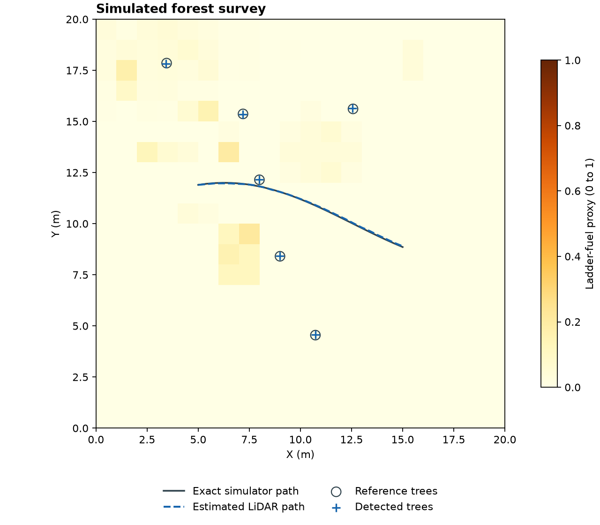

# Canopy Mapping Rover

A simulated ground rover that uses 3D LiDAR to map forest structure beneath the canopy. It estimates the rover's path, combines its scans into a 3D map, measures tree trunks, and shows where low vegetation could help fire climb into the canopy.

The main demo runs on a laptop with **no dataset download, ROS installation, or rover hardware**. The project also processes recorded forest LiDAR from TreeScope.



*Seed 0 survey with CSF ground classification. The map overlays the rover's paths and tree detections on the ladder-fuel heatmap.*

## Why map from below the canopy?

Canopy cover can obscure small trees, shrubs, and low branches in overhead observations. A ground-level scanner provides a complementary view of that layer. We use the distribution of points at different heights to estimate where vegetation forms a potential ladder toward the canopy. The score describes vegetation structure and would need field validation before use in wildfire assessment.

## How it works

1. **Collect scans.** An Open3D simulator ray-casts a virtual LiDAR through a forest with known terrain, trees, shrubs, and rocks. Recorded LiDAR bags and existing point clouds are also supported.
2. **Estimate motion and build a map.** KISS-ICP aligns successive scans to estimate the sensor path. In simulation, ground filtering helps the alignment use distinctive features such as trunks. The map combines the full scans.
3. **Measure the forest.** The analytics estimate ground height, detect stems, measure diameter at breast height (DBH), and calculate vegetation density and a ladder-fuel proxy.
4. **Evaluate the results.** Synthetic ground truth measures mapping error and tree recall. Separate experiments test obstacle avoidance in simulation and point classification with a Random Forest.

[System architecture](docs/architecture.md) · [Plain-language walkthrough](presentation/01-project-explained.md) · [Glossary](docs/glossary.md)

## Quick start

Install Git and use Python 3.10 or 3.11, the versions covered by CI. Open a terminal and clone the repo.

```bash
git clone https://github.com/chikolavosaki-sys/canopy-mapping-rover.git
cd canopy-mapping-rover
```

**Windows PowerShell**

```powershell
python -m venv .venv
.\.venv\Scripts\python.exe -m pip install -e ".[core,odometry,ml,dev]"
.\.venv\Scripts\python.exe scripts/run_all.py --seed 0 --fast --out results/runs/demo
```

**Linux, macOS, or WSL**

```bash
python3 -m venv .venv
source .venv/bin/activate
python -m pip install -e ".[core,csf,odometry,ml,dev]"
python scripts/run_all.py --seed 0 --fast --out results/runs/demo
```

The Windows command uses the built-in RANSAC ground classifier. For the optional cloth simulation filter (CSF), Linux system packages, or fixes for graphics and Python setup, see the [setup guide](docs/SETUP.md).

Open `results/runs/demo/survey_map.png` to see the map. The same folder contains `trees.csv` for stem measurements, `summary.json` for metrics, `report.md` for a readable summary, and `map.npy` for the registered point cloud. Use `--out results/runs/benchmark` without `--fast` to run all 80 navigation trials. Local outputs under `results/runs/` are ignored by Git.

## Results

| Evaluation | Recorded result |
| --- | --- |
| Simulated mapping, seed 0 | Final drift fell from **10.77% to 0.85%** with ground-filtered alignment. The estimated map recovered **6 of 6 trees** with **1.81 cm DBH RMSE**. |
| Simulated navigation, held-out forests | **79 of 80 goals** across seeds 3000–3019 and four forest densities. One rock collision and zero timeouts. |
| Random Forest, four unseen simulated forests | **89.2% point accuracy**. |
| Random Forest, labelled TreeScope VAT-0723 frames | **60% ground recall** and **35% stem recall**, measured on the two labelled classes. |
| Recorded TreeScope WSF-19 | Processed **92 scans** and detected five stems in the cropped map. The reference trees and the estimated map are in different coordinate frames, so per-tree accuracy was left unmeasured. |

The navigation results apply to the simulated rover. The mapping comparison used the RANSAC ground classifier. See the benchmark protocol, metrics, and real-data limits in the supporting documents. [Benchmark outcomes](docs/OUTCOMES.md) · [TreeScope experiment](docs/real-data.md) · [ML evaluation](results/ml/report.md)

## Repository guide

| Path | Start here for |
| --- | --- |
| [`scripts/`](scripts) and [`configs/`](configs) | Running the demo, generating plots, training the classifier, and changing settings |
| [`src/canopy/`](src/canopy) | Simulation, odometry, navigation, forest analytics, and evaluation |
| [`tests/`](tests) and [GitHub Actions](https://github.com/chikolavosaki-sys/canopy-mapping-rover/actions/workflows/ci.yml) | Automated tests, lint, and install checks |
| [`docs/`](docs) and [`presentation/`](presentation) | Setup, design decisions, results, and the live demo walkthrough |
| [`datasets/`](datasets) and [`data/MANIFEST.csv`](data/MANIFEST.csv) | Dataset catalogue and file manifest for optional downloads |
| [`results/`](results) and [`references/`](references) | Saved experiment outputs, papers, and dataset attribution |

## Team

**Prithvi**, **Anwita**, and **Prajjwal** developed this B.Tech CSE semester project at BIT Mesra. The Git history records the implementation and review, and the design log explains why the major changes were made. [Design decisions](docs/decisions.md) · [References and dataset credits](references/README.md)
