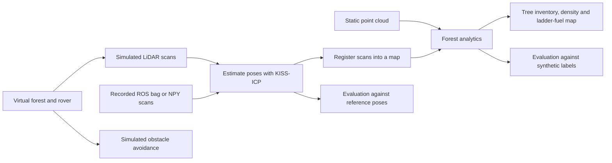

# Architecture

Canopy Mapping Rover turns ground-level LiDAR into a 3D map and measurements of the forest understorey. It uses synthetic scenes for repeatable evaluation and accepts recorded sensor data for offline mapping.

## Data flow

All paths share settings in [`configs/default.yaml`](../configs/default.yaml), loaded by `canopy.config`. The [demo script](../scripts/run_all.py) combines the simulated mapping, analytics and navigation benchmarks and writes a report, maps, tables, and metrics.

## Simulation and navigation

`canopy.simulation` creates forests with known positions, labels, and terrain. Open3D ray-casting models occlusion and range noise against trunk, shrub, crown, rock, and terrain meshes. The mapping LiDAR has 16 beams over 30°. Simulated navigation uses 26 beams over 50° to get more downward coverage while keeping about 2° vertical spacing. [Sensor design decisions](decisions.md)

The navigation controller estimates local ground, retains obstacle points from its last eight scans, and evaluates forward sector distances, corridor clearance, and footprint clearance. It can drive, turn in place, or stop. It commits to a turn direction while blocked and requires extra clearance before resuming. The simulator supplies the exact rover pose for obstacle memory. [Navigation code](../src/canopy/navigation) · [Evaluation code](../src/canopy/evaluation/nav_eval.py)

## Odometry and map registration

`canopy.lidar_odometry` uses KISS-ICP to estimate successive poses from sensor-frame scans and combines the original scans using those poses. The synthetic workflow usually removes ground returns during **alignment** to make distinctive features easier to match. It reverts to all returns when a filtered scan has too few points. **Map registration** still uses the full scans. Recorded bags or NPY frames use all valid returns for alignment. The map uses 2 cm voxels to retain enough trunk points for diameter estimation.

`canopy-odometry` accepts synthetic runs, ROS1/ROS2 bags, and folders of NPY frames. It writes an estimated TUM trajectory, poses, merged point cloud, and summary. The synthetic command also exports the reference path and trajectory errors. `rosbags` reads recordings directly. [Odometry code](../src/canopy/lidar_odometry) · [Real-data commands](running-on-real-data.md)

## Forest analytics

1. Classify ground points with the cloth simulation filter (CSF), or use tiled RANSAC planes when CSF is unavailable.
2. Fit a local ground surface and express point heights relative to that surface.
3. Find stem candidates in the 1.2–1.4 m height slice. Cluster the points, fit circles with RANSAC and geometric refinement, then check arc coverage and verticality.
4. Remove stem points and measure height-band occupancy and the vertical gap toward the crown base. Combine those measurements into the ladder-fuel proxy.

The same pipeline runs on registered maps and static point clouds through `canopy-analyze`. The demo also measures an exact-pose map and the perfect simulated cloud to separate scan-coverage problems from pose errors. [Analytics code](../src/canopy/forest_analytics) · [Benchmark outcomes](OUTCOMES.md)

## Point classification and other modules

The separate Random Forest experiment classifies ground, stem, shrub, crown, and rock. It derives eight features from each point's local neighbourhood, trains on eight simulated forests, and evaluates four unseen synthetic forests and labelled TreeScope ground and stem points. Its predictions are separate from the rule-based forest analytics. [Classifier code](../src/canopy/ml) · [Saved ML report](../results/ml/report.md)

The aerial module contains vegetation and water index helpers. Water-body segmentation remains outside the completed project scope. [Aerial helpers](../src/canopy/aerial_context) · [Water module notes](../src/water_bodies/README.md)

## Validation boundaries

Synthetic scenes provide exact trajectories and labels. TreeScope's processed trajectory comes from Faster-LIO and serves as a reference. The saved WSF-19 map and field-labelled stems use different frames, so per-tree matching remains open. Real shrub labels would help validate the ladder-fuel proxy, and testing the navigation controller on hardware would require a separate field study. [Real-data findings](real-data.md) · [Tests and CI](SETUP.md#run-the-checks-and-demo)
