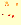

# Synthetic demo results (seed 0)

Generated by `python scripts/run_all.py`. Synthetic data only; see
`docs/OUTCOMES.md` for targets and honest limits.

## Odometry (KISS-ICP vs exact simulated poses)

| Metric | Value |
|---|---:|
| Frames | 26 |
| Path length (m) | 10.67 |
| ATE RMSE (m) | 0.8668 |
| RPE RMSE (m) | 0.0665 |
| Final drift (% of path) | 11.784 |

## Forest analytics

KISS-ICP map: 33067 points from simulated scans registered with
KISS-ICP. Exact-pose map: the same scans with the true poses (so the gap to the
first column is odometry error). Perfect cloud: every forest point (upper bound).

| Metric | KISS-ICP map | Exact-pose map | Perfect cloud |
|---|---:|---:|---:|
| Trees detected | 2 | 11 | 6 |
| Tree recall | 0.1667 | 0.8333 | 0.8333 |
| Tree precision | 0.5000 | 0.4545 | 0.8333 |
| DBH RMSE (m) | 0.1889 | 0.0873 | 0.0059 |
| DBH bias (m) | -0.1889 | 0.0305 | -0.0023 |
| Ladder Spearman vs shrub cells | 0.3824 | 0.5827 | 0.2181 |
| Ladder AUC vs shrub cells | 0.8258 | 0.9131 | 0.8445 |

## Navigation (simulator)

Per-density results: `navigation/navigation_summary.csv`.

| Metric | Value |
|---|---:|
| Runs (seeds x forest densities) | 80 |
| Success rate | 0.938 |
| Collisions | 4 |
| Time-outs | 1 |
| Mean path ratio (driven / straight line) | 1.050 |

