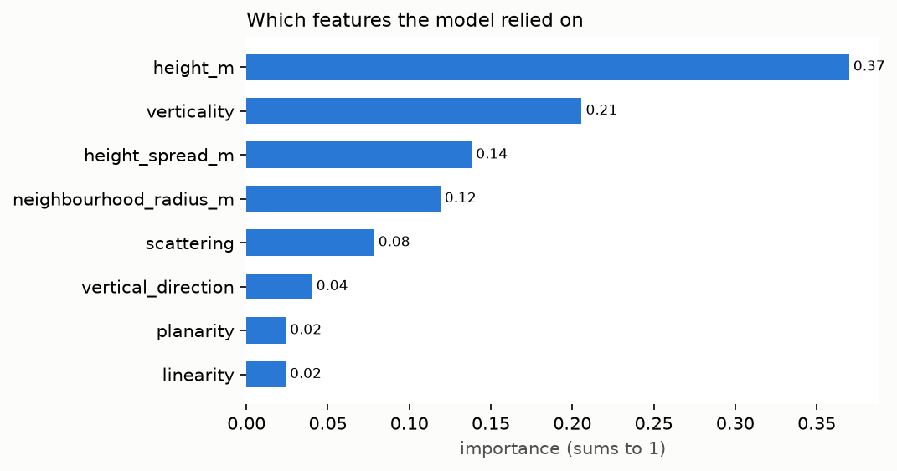

# ML point classifier (Random Forest)

Trained on 92588 labelled points from simulated forests [0, 1, 2, 3, 4, 5, 6, 7]; tested on 41429 points from unseen forests [100, 101, 102, 103].

**Accuracy on unseen forests: 89.5 %**

| Class | Precision | Recall | F1 | Test points |
|---|---:|---:|---:|---:|
| ground | 1.00 | 0.99 | 1.00 | 12000 |
| stem | 0.83 | 0.86 | 0.85 | 12000 |
| shrub | 0.84 | 0.76 | 0.80 | 8342 |
| crown | 0.93 | 0.93 | 0.93 | 1613 |
| rock | 0.88 | 0.92 | 0.90 | 7474 |

Features: height_m, linearity, planarity, scattering, verticality, vertical_direction, height_spread_m, neighbourhood_radius_m.

Limits: trained only on simulated forests (perfect cylinders, flat leaf patches); real forests look messier, and real shrub/crown labels are not available yet to measure those classes on real data.
