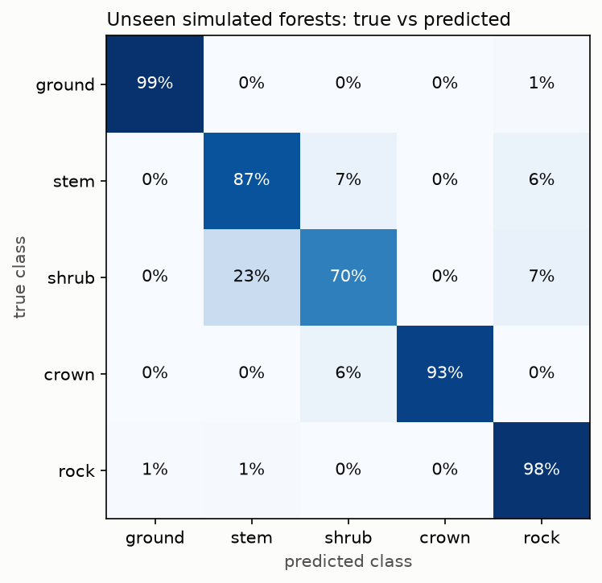

# ML point classifier (Random Forest)

Trained on 92588 labelled points from simulated forests [0, 1, 2, 3, 4, 5, 6, 7]; tested on 41429 points from unseen forests [100, 101, 102, 103].

**Accuracy on unseen forests: 89.2 %**

| Class | Precision | Recall | F1 | Test points |
|---|---:|---:|---:|---:|
| ground | 1.00 | 0.99 | 0.99 | 12000 |
| stem | 0.84 | 0.87 | 0.85 | 12000 |
| shrub | 0.86 | 0.70 | 0.77 | 8342 |
| crown | 0.96 | 0.93 | 0.95 | 1613 |
| rock | 0.83 | 0.98 | 0.90 | 7474 |

## Real data check (TreeScope VAT-0723 labelled frames)

These frames contain only ground and trunk points, so only recall can be measured (precision needs the other classes).

| True class | Recall | Predicted as |
|---|---:|---|
| ground | 0.60 | ground 5362, stem 154, shrub 427, crown 2, rock 3055 |
| stem | 0.35 | ground 16, stem 3166, shrub 1654, crown 3923, rock 241 |

Features: height_m, linearity, planarity, scattering, verticality, vertical_direction, height_spread_m, neighbourhood_radius_m.

Limits: trained only on simulated forests (perfect cylinders, flat leaf patches); real forests look messier, and real shrub/crown labels are not available yet to measure those classes on real data.
